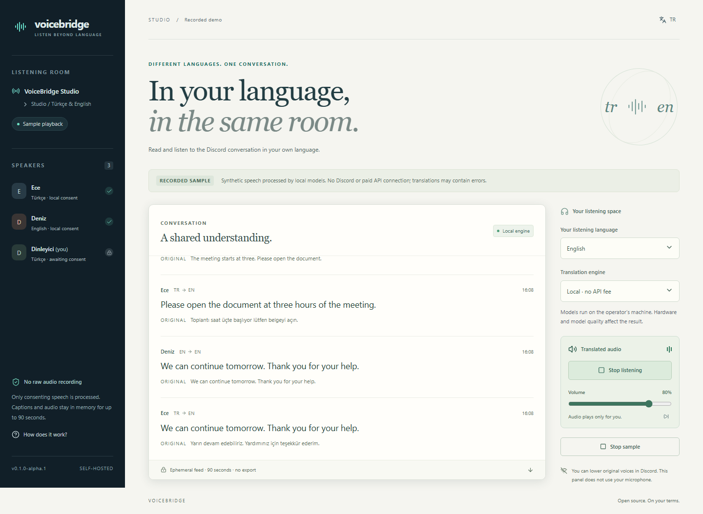

# VoiceBridge

**Alpha.4** adds [per-caption server timing](docs/CAPTION-TIMING.md): inspect queue, recognition, translation and optional speech-generation times. [Operator setup checks](docs/SETUP-CHECKS.md) remain available.

**One conversation. Your language.**

Personal captions and translated speech for Discord voice rooms. Run local models on your own hardware, or bring an owner-funded cloud key. Every speaker controls their own consent; every listener chooses what they hear.

[](https://github.com/nexora-studio-tr/voicebridge/actions/workflows/ci.yml)
[](LICENSE)
[](https://github.com/nexora-studio-tr/voicebridge/releases)

[Türkçe](README.tr.md) · [Setup](docs/SETUP.md) · [Architecture](docs/ARCHITECTURE.md) · [Validation](docs/VALIDATION.md) · [Security](SECURITY.md)

**[Download alpha.4](https://github.com/nexora-studio-tr/voicebridge/releases/tag/v0.1.0-alpha.4)** · **[Join the 5–10-tester beta](docs/BETA.md)** · [Send feedback](https://github.com/nexora-studio-tr/voicebridge/issues/new?template=beta_feedback.yml)



*Recorded synthetic demo; the screenshot contains no private conversation or live account data.*

## Why VoiceBridge

- **Private listening:** Turkish ↔ English captions and opt-in speech play in each listener's browser. The bot does not broadcast translations over the shared room.
- **Consent before capture:** local and cloud consent are separate. Revocation and room departure invalidate pending delivery and old audio access.
- **Local-first processing:** faster-whisper → Argos → Okur/Piper on CPU, without a translation API fee. A local failure never silently switches to paid processing.
- **Bounded by design:** fair speaker queues, shared inference, ephemeral captions/audio and conservative budget reservations before cloud dispatch.

**0.1.0-alpha.2** improves English recognition and utterance boundaries without replacing the local models. A user confirmed correct English text and Turkish captions after the repair. Two-person live acceptance and a 5–10-person cohort are pending; the [beta guide](docs/BETA.md) describes how to help. Billable cloud calls and multi-user capacity remain unverified. Local models can mistranslate clock times. [Validation](docs/VALIDATION.md) records the exact scope.

## Recorded demo

Requires **Node.js 24.17+ (24.x LTS)**. No Python, bot token or API key is needed.

```sh
git clone https://github.com/nexora-studio-tr/voicebridge.git
cd voicebridge
npm ci --ignore-scripts
npm run build
npm run demo
```

Open [127.0.0.1:4348](http://127.0.0.1:4348), enable audio, then start the sample. These are **recorded synthetic samples from the actual local pipeline**, not a live Discord connection or arbitrary-input translator. Switch Turkish/English to inspect personal delivery.

## Full installation

Alpha.3 adds **[guided setup checks and a private support report](docs/SETUP-CHECKS.md)** in the operator's Settings panel. See missing setup steps, then explicitly download a report with no credentials, private IDs or speech. Manual integrity, sign-in and live-voice acceptance remain separate checks.

Install Python **3.12**, allow approximately **3 GB** disk space, then:

```sh
npm ci --ignore-scripts
npm run setup
npm start
```

Setup installs pinned dependencies into `.venv`, downloads separately licensed models with pinned sizes/SHA-256, and builds the app. Setup needs internet; local inference subsequently uses local files and loopback HTTP. Discord needs internet.

Open the private URL in `.voicebridge/operator-link` on the same computer. It expires after 30 minutes and works once. Enter a **dedicated** Discord application ID, bot token, OAuth client secret and allowed guild IDs there. Saving does not connect the bot. See [setup](docs/SETUP.md) for OAuth, remote HTTPS and final live testing.

## In a room

1. A member with **Manage Server** joins a normal voice channel and runs `/voicebridge start` (`baslat` in Turkish Discord).
2. Members sign into the panel with Discord. The backend checks current voice membership and permissions, not just identity.
3. Each speaker chooses their spoken language and separately consents to local/cloud processing. Without consent, their audio is not subscribed to.
4. Each listener selects Turkish/English and local/cloud. Speech is opt-in and plays privately in the browser; the panel never opens a microphone.
5. Revocation, departure, preference changes and disconnection invalidate pending delivery and old audio URLs. Already heard speech or dispatched provider requests cannot be recalled.

The bot stays in the room, self-muted, receiving consenting speakers. Translations are not broadcast into the common room. Lower original voices in Discord if desired.

## Engines and budgets

| Stage | Local, no API fee | Cloud, owner's key |
|---|---|---|
| Recognition | faster-whisper base / CPU int8 | gpt-transcribe |
| Translation | Argos pair models / CTranslate2 int8 | gpt-realtime-2.1-mini text |
| Speech | Okur ONNX (TR), Piper LJSpeech (EN) | gpt-realtime-2.1-mini synthetic audio |

Cloud defaults off with zero caps. It requires an owner key, reviewed prices, enabled budgets, an active listener choosing cloud and speaker cloud consent. A local-only speaker stays local, visibly labelled. Local failure never silently triggers paid processing.

Daily, monthly, room-session and per-user/day budgets reserve estimated cost **before dispatch**, atomically in SQLite. Timeouts retain uncertain reservations; restart does not refund potentially billed work. Unexpected overruns disable cloud. These are conservative estimates, **not invoices or an absolute spending guarantee**; configure provider-side limits too. No payment collection, credits or subscriptions.

## Data and limits

- Captions/audio access expires after 90 seconds. In-memory caches are bounded and swept. No raw voice recording, permanent transcript/export or public audio-upload endpoint.
- Runtime data is excluded from packages. Keys use AES-256-GCM with a local master-key file. Protect the host and backups.
- One channel per guild/bot identity. Bounded queues rotate waiting speakers. Only active web subscribers trigger inference.
- Bounded utterances, not word-by-word simultaneous interpretation. Warmup, hardware, queueing, accents and model quality affect results. No unlimited-capacity claim.
- Model weights have separate licenses and are not bundled. Withdrawn Turkish voices are excluded. See [notices](THIRD_PARTY_NOTICES.md).

## Verify

```sh
npm run check
npx playwright install chromium
npm run test:browser
# After model setup:
npm run test:local
npm run test:worker
```

Python safety tests: project-venv `python -m unittest discover -s worker/tests -v`. Reports/screenshots go to ignored `artifacts/`. The [initial GitHub Actions run](https://github.com/nexora-studio-tr/voicebridge/actions/runs/40196645739) passed on Ubuntu and Windows. [Validation](docs/VALIDATION.md) distinguishes these source/demo checks from model installation, live use and quality gates.

## Contribute

Start with the [contribution guide](CONTRIBUTING.md), [roadmap](ROADMAP.md) and [code of conduct](CODE_OF_CONDUCT.md). Reproducible translation failures, accessibility feedback and multi-user test reports are especially useful. Use synthetic examples and never attach real conversations or credentials to an issue.

Source: **GPL-3.0-or-later**, [LICENSE](LICENSE), [NOTICE](NOTICE). Dependencies and separately downloaded model weights retain their own licenses.
