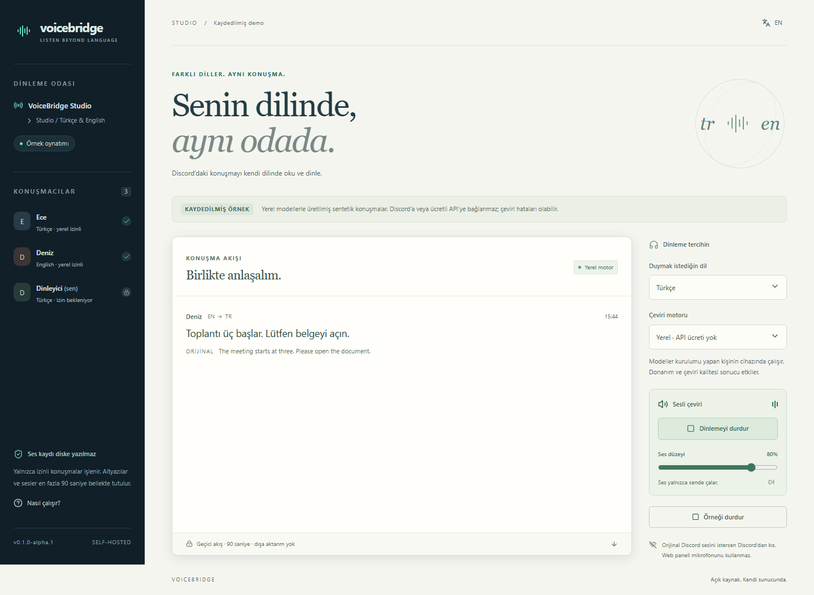

# VoiceBridge

**Alpha.7**, operatöre özel [performans ekranını](docs/PERFORMANCE.md) ekler: kuyruk yükü, ayrı yerel/bulut süreleri ve konuşma içermeyen sayısal rapor. [Güvenli oda bağlantısı](docs/ROOM-RECOVERY.md) ve [Windows başlatıcısı](docs/WINDOWS.tr.md) kullanılabilir.

Alpha.3, operatörün Ayarlar paneline **[kurulum kontrolü ve özel destek raporu](docs/SETUP-CHECKS.md)** ekler. Eksik adımları görüp anahtar, özel ID veya konuşma içermeyen raporu kendin indirebilirsin. Bütünlük, giriş ve gerçek ses kabul testleri ayrıca yapılır.

**Discord ses odaları için kişiye özel altyazı ve sesli çeviri. Kendi bilgisayarında veya sunucunda çalışır.**

[](https://github.com/nexora-studio-tr/voicebridge/actions/workflows/ci.yml)
[](LICENSE)
[](https://github.com/nexora-studio-tr/voicebridge/releases)

[English](README.md) · [Kurulum](docs/SETUP.tr.md) · [Test durumu](docs/VALIDATION.md) · [Kalite ölçümü](docs/QUALITY.tr.md) · [Yol haritası](ROADMAP.md)

**[Alpha.7 indir](https://github.com/nexora-studio-tr/voicebridge/releases/tag/v0.1.0-alpha.7)** · [Beta doğrulama kaydı](docs/BETA-STATUS.md) · [Geri bildirim gönder](https://github.com/nexora-studio-tr/voicebridge/issues/new?template=beta_feedback.yml)

## Nereden başlayacaksın?

| Deneme                      | Gerekenler                                                         | Başlangıç                                                   |
| --------------------------- | ------------------------------------------------------------------ | ----------------------------------------------------------- |
| Kayıtlı demoyu gör ve dinle | Node.js 24.17+ / 24.x; Python, bot veya anahtar gerekmez           | [Demo](#demo)                                               |
| Windows x64 üzerinde kur | Windows, hazırlık için 6 GB boş alan, internet ve kendi Discord botun | [Çift tıklanan başlatıcı](docs/WINDOWS.tr.md) |
| Beta kurulumu yap           | Kendi cihazın, Python 3.12, model indirmeleri ve ayrı Discord botu | [Kurulum sahibi rehberi](docs/BETA.tr.md#temiz-kurulum-yap) |

Başkasının gerçek odasına mı katılacaksın? Onun erişilebilir panel adresinde kendi Discord hesabınla giriş yap; model kurmaz, anahtar paylaşmazsın. [Katılımcı adımları](docs/BETA.tr.md#misafir-olarak-katıl).



_Görselde sentetik örnekler kullanılır; gerçek kullanıcı konuşması veya hesap bilgisi bulunmaz._

## Neden VoiceBridge?

- Herkes aynı odadayken altyazı ve sesli çeviriyi kendi dilinde, kendi tarayıcısından alır.
- Konuşmacının yerel ve bulut izinleri ayrıdır. İzin iptali ve odadan ayrılma, bekleyen çıktıyı ve eski ses erişimini kapatır.
- Yerel modeller CPU üzerinde API ücreti olmadan çalışır. Yerel hata nedeniyle kendiliğinden ücretli moda geçilmez.
- Konuşmacı sırası, paylaşılan çıkarım ve bulut isteği öncesi bütçe ayırma ile kaynak kullanımı sınırlandırılır.

**0.1.0-alpha.2**, mevcut yerel modelleri değiştirmeden İngilizce algılamayı ve konuşma parçalarının sınırlarını iyileştirir. Düzeltme sonrası tek kullanıcılı denemede İngilizce metin ve Türkçe altyazı doğru çıktı. İlk beta hedefi sonuçları incelenmiş iki bağımsız temiz kurulum. İki kişilik gerçek test ve 5–10 kişilik grup ayrı hedefler ve henüz tamamlanmadı; [beta rehberinde](docs/BETA.tr.md) katılım adımları var. Ücretli API ve çok kullanıcılı kapasite doğrulanmadı. [Alpha.7 sentetik ölçümü](docs/reports/QUALITY-BASELINE-2026-10-29.tr.md), doğru tanıma sonrasında bile sayı, tarih, isim ve olumsuzluk çevirilerinde kritik hatalar kaydeder; genel kalite kabulü açık kalır. [Test kapsamı](docs/VALIDATION.md).

## Demo

Node.js **24.17+ / 24.x LTS** gerekir; bot hesabı, Python ve API anahtarı gerekmez.

```sh
git clone https://github.com/nexora-studio-tr/voicebridge.git
cd voicebridge
npm ci --ignore-scripts
npm run build
npm run demo
```

[127.0.0.1:4348](http://127.0.0.1:4348) adresinde **Sesli dinlemeyi aç**, sonra **Örneği başlat** düğmesine bas. Gerçek yerel modellerle üretilmiş dört sentetik konuşmanın kayıtlı çıktısı oynatılır. Canlı Discord veya rastgele girdi işleme demosu değildir.

## Tam kurulum

Windows x64 için [taşınabilir başlatıcı](docs/WINDOWS.tr.md), Node/Python ortamını kendi hazırlar. Aşağıdaki komutlar kaynak koddan kurulum içindir.

Python **3.12** ve yaklaşık **3 GB** boş disk hazır olsun. GPU zorunlu değildir.

```sh
npm ci --ignore-scripts
npm run setup
npm start
```

Kurulum bağımlılıkları `.venv` içine kurar, sabit sürüm ve SHA-256 ile modelleri indirir. İlk kurulum internet ister. Yerel çıkarım dosyalardan çalışır; Discord bağlantısı internet kullanır.

`.voicebridge/operator-link` içindeki özel adresi aynı bilgisayarda aç. Bağlantı tek kullanımlıktır, 30 dakika geçerlidir. VoiceBridge'e **ayrı** bir bot uygulaması tanımla; uygulama ID, token, OAuth client secret ve izin verilen sunucu ID'lerini buradan gir. Kaydetmek bağlantıyı başlatmaz. Anahtarlarını yalnızca kurulum formuna gir.

## Kullanım

1. **Sunucuyu Yönet** yetkili kişi normal ses odasında `/voicebridge start` kullanır; Türkçe Discord'da `baslat` görünebilir.
2. Üyeler panelde Discord ile giriş yapar. Backend aynı odada bulunmayı ve kanal izinlerini doğrular.
3. Her konuşmacı kendi dilini ve ayrı **yerel/bulut** izinlerini seçer. İzinsiz kişinin sesine abone olunmaz.
4. Her dinleyici hedef dilini/motorunu seçer. Sesli dinleme ayrıca açılır ve yalnızca kendi tarayıcısından duyulur. Panel mikrofon istemez.
5. İzin iptali, odadan ayrılma veya tercih değişikliği bekleyen teslimatı ve eski ses erişimini geçersiz kılar. Önceden duyulan ses veya sağlayıcıya ulaşan istek geri alınamaz.

Bot odada mikrofonu kapalı biçimde dinler; ortak odaya çeviri sesi vermez. Orijinal sesleri istersen Discord'dan kısabilirsin.

Yerel mod faster-whisper, Argos, Türkçe Okur ve İngilizce Piper/LJSpeech kullanır. Çeviri API ücreti yoktur; donanım/elektrik kullanılır. Bulut sunucu sahibinin anahtarını ve bütçesini kullanır; varsayılan kapalı ve limitleri sıfırdır. Anahtar, güncel fiyatlar, bütçe, dinleyici tercihi ve konuşmacı bulut izni birlikte gerekir. Bulut izni olmayan konuşmacı yerel kalır ve bu gösterilir. Yerel hata nedeniyle kendiliğinden ücretli moda geçilmez.

Günlük, aylık, oda/oturum ve kullanıcı/gün bütçeleri vardır. Her ücretli aşamadan önce tutar atomik ayrılır. Zaman aşımı ücretsiz sayılmaz. Beklenmedik aşım bulutu kapatır. Gösterilen tutarlar **tahmindir; fatura veya mutlak harcama garantisi değildir**. Sağlayıcı tarafında da limit kullan. Proje ödeme almaz veya kredi satmaz.

Ham ses diske kaydedilmez. Altyazı/ses erişimi 90 saniye sonra sona erer; önbellekler sınırlıdır. Çalışma verisi `.voicebridge` içindedir ve kaynak paketine girmez. Bir bot her sunucuda bir ses odasını işler. Cümle parçaları sıraya alınır; sınırsız kapasite veya sözcük sözcük eşzamanlılık iddiası yoktur.

Uzak dinleyiciler için erişilebilir **HTTPS** adresin gerekir; `127.0.0.1` başka cihazlardan açılamaz. [Kurulum ve sorun çözümü](docs/SETUP.tr.md). [Model lisansları](THIRD_PARTY_NOTICES.md) ayrıdır; kaldırılmış Türkçe sesler dağıtılmaz.

Kontroller: `npm run check`, `npm run test:browser`; modeller kuruluysa `npm run test:local` ve `npm run test:worker`. Python komutlarında `.venv` kullan. Tek kullanıcılı yerel canlı kontrol tamamlandı; ücretli API ve çoklu kullanıcı kapasitesi bu kontrolün dışındadır.

Katkı için [katkı rehberini](CONTRIBUTING.md), [davranış kurallarını](CODE_OF_CONDUCT.md) ve [yol haritasını](ROADMAP.md) incele. Hata örneklerinde sentetik veri kullan; gerçek konuşma veya anahtar paylaşma.

Kod lisansı **GPL-3.0-or-later**. Bağımlılıkların ve ayrıca indirilen model ağırlıklarının kendi lisansları geçerlidir.
