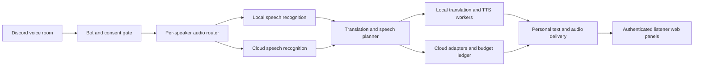

# Architecture baseline

Implemented alpha architecture. Dependencies and model files are pinned. Bounded local Discord compatibility was checked; multi-user/provider compatibility and general translation quality remain open gates; see [VALIDATION.md](VALIDATION.md).

## Components

Cloud edges operate only when the owner enabled the provider, a listener selected the cloud profile, the speaker consented to cloud processing and budget reservation succeeded. An unmet condition keeps that speaker's segment local or pauses it with an explicit reason. Automated checks use synthetic speech; a separately identified one-user Discord check used local inference. No billable provider calls were made.

- TypeScript bot/API owns Discord integration, authorization, room lifecycle, routing and cost policy.
- Python workers own the local recognition, translation and speech model adapters. An authenticated, bounded internal protocol separates workers from public requests.
- A React/TypeScript web panel provides personal captions, language/mode selection, audio controls and operator settings. Existing accessible primitives are used for controls.
- SQLite is the initial durable store for configuration, membership-independent session metadata, encrypted provider configuration, budget reservations and usage observations. Live media stays outside the database.
- Provider adapters expose recognition, translation and synthesis independently. Current adapters: faster-whisper base, Argos/CTranslate2, Turkish Okur ONNX, English Piper LJSpeech, and OpenAI (live-unverified).

## Isolation and credentials

Owner/admin manages providers and budgets. A participant can control only their own listening preferences and consent. Administrative actions recheck current Discord permissions on the server.

OAuth login is not sufficient by itself: every subscription and media request is bound to a guild, room and live voice membership. Revoked membership disconnects subscriptions and invalidates short-lived media access. Already heard/downloaded information cannot be recalled.

Provider keys never reach listener responses, frontend bundles, URLs, logs or exports. Stored secrets require an operator-controlled encryption key outside the database. Arbitrary user-supplied provider URLs are not supported in the initial adapters. No Discord user token/self-bot access is used.

Bot and workers run under a trusted operator account. Authentication protects the web service; this does not claim protection against that machine's administrator.

## Speech and delivery semantics

Audio is routed by the Discord speaker stream identity; a voice-cloning/biometric identification system is not required. Decoder errors, large timing gaps and reconnect boundaries are treated as discontinuities. Fine-grained RTP packet-loss detection is not implemented; the receive library may conceal some loss.

An utterance has stable room/speaker/sequence identity. The initial implementation commits bounded utterances, without partial word streaming. Captions are delivered before synthesis; an audio update replaces the same caption ID.

The English receive profile waits 900 ms before ending a stream. At six seconds it can commit at a quiet PCM boundary; twelve seconds is the hard memory/context cap. The Turkish profile retains its six-second cap and 450 ms stream timeout. Interruption clears pending PCM. These bounds improve context at the cost of additional English end-of-utterance latency; continuous speech can still meet the hard cap.

Local English uses the existing pinned multilingual base model with five-beam, temperature-zero decoding and 700 ms VAD silence. Turkish retains greedy decoding and 350 ms VAD silence. Previous-text conditioning stays off for both languages, preventing recognition prompts from carrying another speaker's text forward. No extra model, API key or automatic cloud fallback is required.

Recognition is shared per room, speaker and actual engine profile. Listeners can choose local/cloud independently; at most the requested authorized profiles run. Translation and synthesis are shared within a room only when language, engine, voice, source revision and owner credential profile match. There is no cross-room cache of private conversation data.

Cancellation, mode/language switching and reconnects carry generation numbers. Late results from obsolete generations are discarded. A bounded browser audio queue supports stop/skip; old audio is not replayed after reauthorization. The initial delivery design uses authenticated text events and expiring same-origin audio segments; delivery uses cookie-authenticated SSE and short-lived WAV URLs.

Separate per-speaker queues, limits, fairness and backpressure prevent one noisy stream from consuming all compute. Low capacity produces a visible delay/pause state, not a silent cloud charge. Hard limits are 20 rooms, 30 listeners/room, 50 participants/room, eight waiting jobs globally and two waiting jobs per speaker; they are safety bounds, not capacity claims.

## Consent and retention

States are separate: absent, pending consent, local allowed, cloud allowed, stopped. Only subscribed/allowed streams enter decoding/inference. New participants do not inherit another person's consent. Revocation cancels queued work; an already transmitted cloud request cannot be retracted by the bot.

Raw audio and playable segments have bounded memory lifetimes and are excluded from application logs. First-version persistence does not include a conversation archive. Diagnostic retention contains counts, timing, error categories and non-content operation identifiers. Optional content diagnostics would require a separate explicit opt-in and are not a default.

## Costs and failures

The operator-only [performance view](PERFORMANCE.md) summarizes a five-minute, 512-event numeric window in process memory. It distinguishes local/cloud caption/audio output groups, shared work, queue waits and terminal job outcomes without retaining identities, text, audio, paths or raw errors. Strict-schema snapshots use no-store responses and an explicit local JSON download. Node-process memory excludes Python/model memory. This is operational visibility, not a capacity or speech-quality result.

The owner configures monthly/daily caps, per-room and per-listener limits, enabled profiles and maximum concurrency. Before an outbound request, the coordinator atomically reserves estimated usage. Returned usage reconciles the reservation; uncertain results retain a conservative charge estimate. Unknown prices disable that profile until configured.

Each shared operation is reserved once against guild/room and the first requesting listener of that group. No blind provider retries are made. The ledger does not claim exactly-once provider billing or absolute invoice caps.

Budget exhaustion stops new cloud work and offers the listener local continuation. Switching to cloud always remains explicit. A local fallback is labelled and never represented as a successful cloud result.

## Deferred features

Hosted subscription billing, credit sales, multiple concurrent rooms per bot identity in one guild, shared-channel translated audio, voice cloning, permanent recordings, unlimited language/capacity claims and mobile-native applications are outside the first release.
