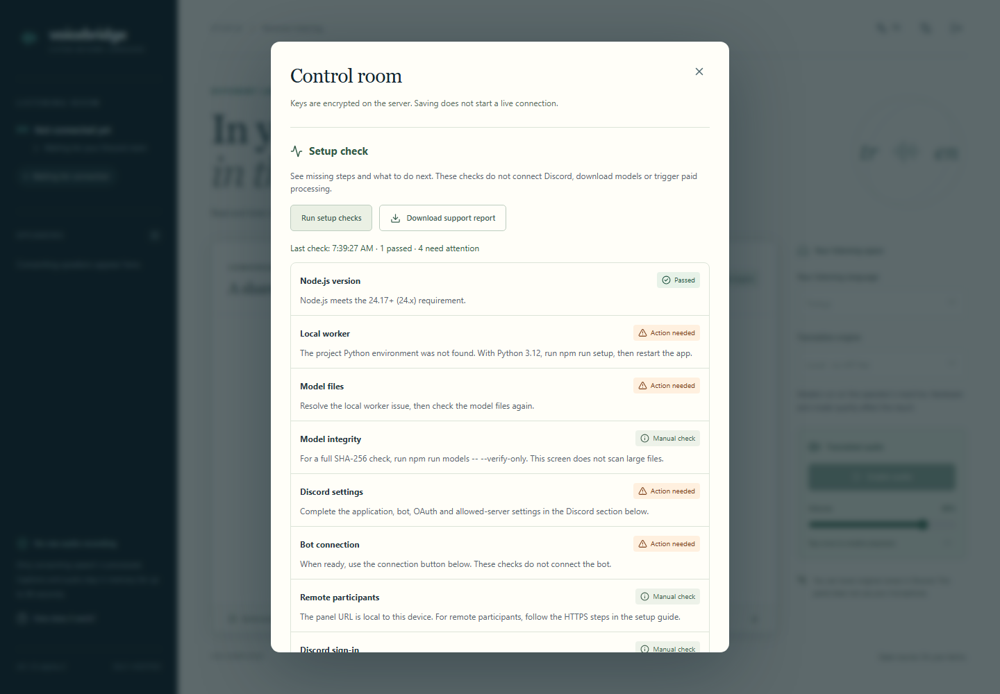
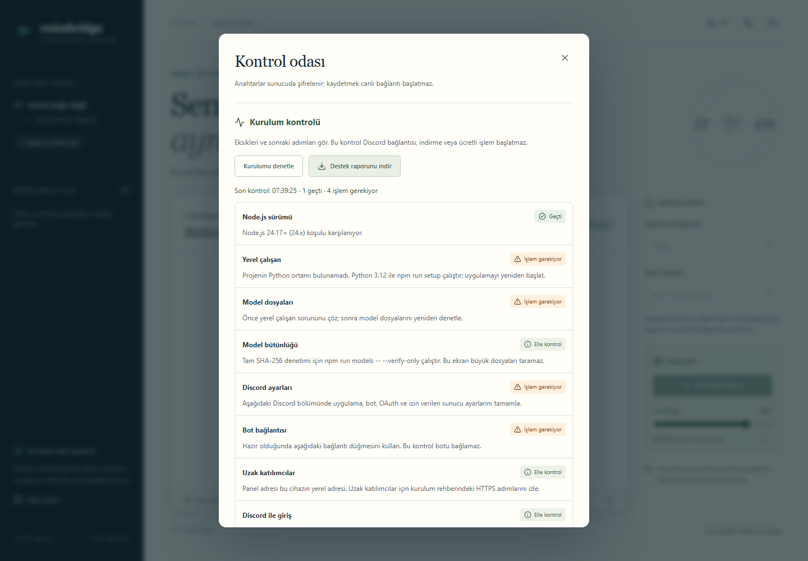

# Setup checks / Kurulum kontrolü

Included from **0.1.0-alpha.3**. The alpha.2 download does not include this panel.

## English

*Isolated test profile with a deliberately absent Python environment; no live Discord data.*

Open the private operator link on the installation host, then choose **Settings → Run setup checks**. The endpoint is `GET /api/operator/setup-checks`; it requires an authenticated instance operator. Ordinary Discord members, server administrators without the operator session, anonymous visitors and recorded demos cannot use it.

The panel checks the supported Node version, whether the existing local worker responds, model-file presence, saved Discord configuration and the current Gateway-ready state. Each result includes the next step. No bot connection, model download, speech capture, translation or paid API request is started. Health requests use the existing authenticated loopback worker and its three-second timeout; concurrent checks share that probe.

**Presence is not integrity or quality.** The worker reports expected file presence, not successful model loading or inference. Run `npm run models -- --verify-only` separately for pinned SHA-256 verification. HTTPS configuration does not prove remote reachability/certificate validity. Compare the exact OAuth callback in the Discord settings with Developer Portal, and complete the normal sign-in flow yourself. Two-person speech, accents, translation accuracy, consent revocation and room departure remain separate acceptance tests. A custom inference adapter leaves the standard Python/model checks manual.

Choose **Download support report** only if you need it. The JSON contains schema/app/Node versions, check time, OS/architecture and fixed check IDs/states/reasons. It excludes credentials, OAuth/operator links, Discord/user/guild IDs, addresses, file paths, logs, transcripts and audio. It stays in browser memory until you explicitly download it; it is never sent to GitHub or another service automatically. Review it before attaching it to a beta report. Download is disabled until a check completes, and saving settings clears the previous snapshot. A downloaded file remains a historical snapshot; rerun checks after configuration changes or restarts.

If the worker is missing, use Python 3.12 to run `npm run setup`, restart the app and check again. If it is still starting, wait for startup and rerun the checks. Other manual tests are listed in the [beta guide](BETA.md) and [validation record](VALIDATION.md).

## Türkçe

*Python ortamı bilerek eksik bırakılmış, yalıtılmış test profili. Gerçek Discord verisi yoktur.*

Kurulumu yapan cihazdaki özel operatör bağlantısını açıp **Ayarlar → Kurulumu denetle** düğmesini kullan. API yalnızca kurulum operatörünün doğrulanmış oturumuna açıktır. Normal üyeler, operatör oturumu bulunmayan sunucu yöneticileri, giriş yapmamış ziyaretçiler ve kayıtlı demo erişemez.

Panel; Node sürümünü, mevcut yerel çalışanın yanıtını, model dosyalarının varlığını, kayıtlı Discord ayarlarını ve botun güncel bağlantı durumunu gösterir. Her sonucun yanında sonraki adım bulunur. Botu bağlamaz; model indirmez, ses yakalamaz, çeviri veya ücretli API çağrısı yapmaz. Aynı anda gelen kontroller üç saniyelik zaman aşımı olan, kimliği doğrulanmış yerel durum isteğini paylaşır.

**Dosya varlığı, bütünlük veya kalite doğrulaması değildir.** Tam SHA-256 denetimi için `npm run models -- --verify-only` komutunu ayrıca çalıştır. HTTPS ayarı, uzaktan erişimin veya sertifikanın doğrulandığı anlamına gelmez. Discord bölümündeki tam OAuth dönüş adresini Developer Portal ile karşılaştırıp normal giriş akışını kendin dene. İki kişilik ses, farklı aksanlar, çeviri doğruluğu, izin iptali ve odadan ayrılma ayrıca sınanmalıdır. Özel çeviri adaptörü, standart Python/model kurulumunu doğrulamaz.

Gerekirse **Destek raporunu indir** düğmesini kullan. JSON yalnızca şema/uygulama/Node sürümlerini, kontrol zamanını, işletim sistemi/mimariyi ve sabit kontrol kodlarını içerir. Anahtar, bağlantı token'ı, Discord/kullanıcı/sunucu ID'si, adres, dosya yolu, günlük, konuşma metni veya ses içermez. İndirmeden önce yalnızca tarayıcı belleğinde tutulur; hiçbir servise otomatik gönderilmez. Paylaşmadan önce incele. Kontrol tamamlanana kadar indirme kapalıdır; ayar kaydı önceki sonucu temizler. İndirilmiş dosya geçmiş anın kaydıdır; ayar değişikliği veya yeniden başlatma sonrasında yeniden kontrol et.

Yerel çalışan eksikse Python 3.12 ile `npm run setup` çalıştırıp uygulamayı yeniden başlat. Başlangıç sürüyorsa tamamlandıktan sonra yeniden denetle. Diğer elle testler [beta rehberinde](BETA.tr.md) ve [doğrulama kaydında](VALIDATION.md) yer alır.
